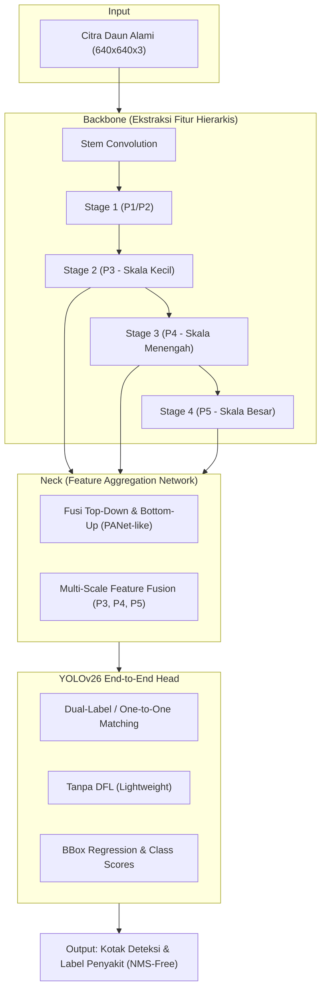
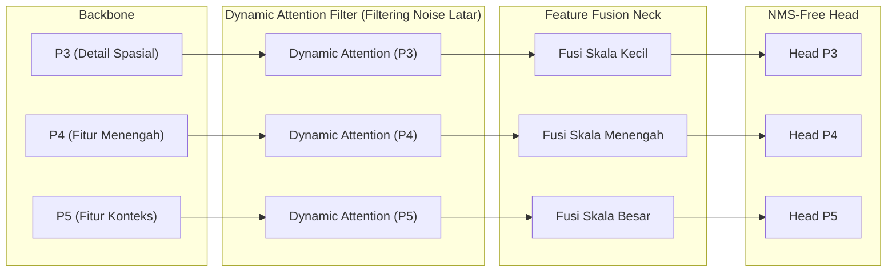

# Kajian Arsitektur: Deteksi Multi-Penyakit Daun di Lingkungan Alami

## Pendekatan YOLOv26 + Dynamic Attention pada Dataset PlantDoc

> **Mata Kuliah:** Computer Vision
> **Program Studi:** S1 Teknik Komputer, Fakultas Ilmu Komputer, Universitas Brawijaya
> **Topik:** Deteksi Multi-Penyakit pada Daun di Lingkungan Alami (*In-the-Wild*)
> **Fokus Utama:** Mitigasi *Background Noise* (Tanah, Bayangan, Daun Tumpang-Tindih) Menggunakan *Dynamic Attention*

---

## 1. Latar Belakang Masalah & Karakteristik Dataset PlantDoc

### 1.1 Mengapa Bukan PlantVillage?

Sebagian besar penelitian awal deteksi penyakit tanaman menggunakan dataset **PlantVillage**. Namun, PlantVillage diambil di dalam laboratorium dengan latar belakang seragam (kertas putih atau abu-abu polos) dan satu daun per citra. Model yang mencapai akurasi 99% di PlantVillage hampir selalu gagal ketika diuji di perkebunan nyata.

### 1.2 Tantangan Unik Dataset PlantDoc (*In-the-Wild*)

Dataset **PlantDoc** dirancang khusus untuk memodelkan kondisi lapangan nyata (*in-the-wild*). Karakteristik visual yang menjadi tantangan utama meliputi:

1. **Background Noise Tinggi:** Latar belakang terdiri dari tanah basah/kering, serasah dedaunan, gulma, langit terik, hingga tangan petani yang memegang daun.
2. **Variasi Pencahayaan & Bayangan:** Pantulan sinar matahari langsung (*glare*) dan bayangan pekat (*hard shadows*) sering memicu deteksi palsu (*false positive*).
3. **Daun Saling Bertumpuk (*Occlusion*):** Beberapa daun dengan penyakit berbeda dapat berada dalam satu frame dan saling menutupi sebagian.
4. **Multi-Scale Lesions:** Ukuran lesi penyakit sangat bervariasi—mulai dari bintik karat mikro (*Corn rust* / *Apple rust*) hingga busuk daun makro (*Late blight* yang memakan separuh daun).
5. **Multi-Class Multi-Object:** Berdasarkan file konfigurasi dataset lokal (`archive/data.yaml`), terdapat **30 kelas** yang mencakup daun sehat dan terinfeksi dari beragam tanaman (apel, tomat, kentang, jagung, kedelai, dsb.).

---

## 2. Arsitektur YOLOv26: State-of-the-Art Real-Time Detector

YOLOv26 mempertahankan paradigma *one-stage detector* (cepat dan efisien), tetapi merombak mekanisme inferensi dan *loss function* untuk mengatasi keterbatasan versi-versi sebelumnya.



### 2.1 Komponen Struktural Utama

* **Backbone (Feature Extractor):** Mengambil fitur visual dari tingkat rendah (*low-level: tepi, warna, tekstur bercak*) ke tingkat tinggi (*high-level semantic: pola gejala penyakit khas*).
* **Neck (Feature Aggregator):** Menjembatani resolusi spasial tinggi (P3 untuk lesi kecil) dengan informasi semantik kuat (P5 untuk daun besar) agar model mampu mendeteksi lesi di berbagai skala.
* **Head (Predictor):** Memprediksi koordinat *bounding box* $(x, y, w, h)$ dan distribusi probabilitas kelas penyakit.

### 2.2 Terobosan Khusus YOLOv26 yang Relevan untuk Proyek

1. **Native End-to-End NMS-Free Inference:**
   * *Problem YOLO Lama:* Memerlukan tahap *Non-Maximum Suppression* (NMS). Ketika daun saling bertumpuk (*dense overlapping*), NMS sering menghapus kotak deteksi yang valid karena dianggap redundan (*false negative*).
   * *Solusi YOLOv26:* Menggunakan penugasan label *one-to-one* saat pelatihan. Model secara langsung memprediksi tepat satu *bounding box* per objek tanpa perlu penyaringan NMS pasca-pemrosesan. Hasilnya: inferensi lebih cepat dan lebih akurat pada daun yang berhimpitan.
2. **Penghapusan DFL (*Distribution Focal Loss*):**
   * Menyederhanakan struktur regresi koordinat, mengurangi jumlah parameter pada *head*, dan mempermudah konversi ke *hardware edge* (seperti Jetson Nano, Raspberry Pi, atau Coral TPU).
3. **STAL (*Small-Target-Aware Label Assignment*) & ProgLoss:**
   * Mekanisme alokasi label yang secara adaptif memperbesar bobot gradien pada objek berukuran kecil. Hal ini krusial untuk mendeteksi lesi tahap awal (*early leaf spot* atau *bacterial spot*).
4. **MuSGD Optimizer:**
   * Pengoptimal hibrida SGD + Muon yang menjaga stabilitas gradien pada data bervarian tinggi (*noisy background*).

---

## 3. Mekanisme Dynamic Attention

### 3.1 Mengapa Perlu "Dynamic Attention"?

Konvolusi standar dan perhatian statis (*static attention*) memiliki bobot yang seragam untuk setiap koordinat citra. Akibatnya, area tanah, bayangan, dan gulma tetap diproses dengan alokasi representasi yang besar, sehingga mengaburkan fitur bercak penyakit.

**Dynamic Attention** menghitung bobot perhatian, ukuran *receptive field*, atau jalur rute fitur **secara adaptif sesuai konten citra yang masuk (*content-aware & input-dependent*)**.

```
[Fitur Masukan] ───► [Evaluasi Konten Citra] ───► [Penyesuaian Bobot / Rute Dinamis]
                                                          │
          ┌───────────────────────────────────────────────┴───────────────────────────────┐
          ▼                                                                               ▼
[Area Daun & Bercak Lesi]                                                        [Area Tanah & Bayangan]
  --> Bobot Diperkuat / Diarahkan                                                 --> Bobot Ditekan / Diabaikan
```

### 3.2 Opsi Varian Dynamic Attention untuk Proyek Anda

| Varian Dynamic Attention                                                               | Prinsip Kerja                                                                                                                                                     | Keunggulan Khusus untuk PlantDoc                                                                                                                  |
| :------------------------------------------------------------------------------------- | :---------------------------------------------------------------------------------------------------------------------------------------------------------------- | :------------------------------------------------------------------------------------------------------------------------------------------------ |
| **1. Bi-level Routing Attention (BRA / BiFormer)** *(Sangat Direkomendasikan)* | Fitur dibagi menjadi region-region (*patch*). Sistem membuat *routing graph* dinamis dan hanya menghitung *attention* ke region paling relevan (top-$k$). | **Mengisolasi noise:** Patch tanah/langit langsung dieliminasi dari grafik komputasi; perhatian difokuskan hanya antar patch daun dan lesi. |
| **2. Dynamic Head (DyHead)**                                                     | Menyatukan tiga dimensi perhatian:*scale-aware* (antar level fitur), *spatial-aware* (antar posisi spasial), dan *task-aware* (klasifikasi vs regresi).     | Sangat unggul jika penyakit daun memiliki variasi ukuran ekstrem (bintik mikro vs busuk daun makro).                                              |
| **3. Dynamic Snake Convolution (DSConv)**                                        | Titik-titik sampling konvolusi dapat melengkung (*deformable*) mengikuti arah struktur tubular/ireguler.                                                        | Cocok untuk mendeteksi tulang daun yang terinfeksi atau lesi yang merambat di sepanjang urat daun.                                                |
| **4. Omni-dimensional Dynamic Convolution (ODConv)**                             | Menerapkan perhatian dinamis 4 dimensi:*kernel space*, input channel, output channel, dan spatial.                                                              | Ekstraksi fitur kaya tanpa menambah beban parameter secara berlebih.                                                                              |

---

## 4. Desain Integrasi: YOLOv26 + Dynamic Attention

### 4.1 Titik Penyisipan pada Arsitektur

Untuk memecahkan masalah *background noise*, titik paling strategis untuk menyisipkan modul *Dynamic Attention* adalah pada **Neck (Feature Aggregator)** atau sebagai jembatan **antara Backbone dan Neck**:



### 4.2 Alasan Memilih Penempatan di Neck:

1. **Pembersihan Fitur Sebelum Fusi:** Menyaring fitur tanah/bayangan sebelum informasi digabungkan (*concatenated/added*) antar level resolusi, mencegah perambatan noise ke skala lain.
2. **Efisiensi Komputasi (Ramah Perangkat Tepi):** Menaruh perhatian dinamis di seluruh lapisan *backbone* awal akan membuat model menjadi berat (*high latency*). Menaruhnya di Neck menjaga kompleksitas GFLOPs tetap rendah.

---

## 5. Parameter & Strategi Evaluasi (Fokus Prodi Teknik Komputer)

Sebagai proyek akhir di Prodi Teknik Komputer, pengujian harus mencakup dua pilar: **akurasi deteksi** dan **efisiensi perangkat keras**.

### 5.1 Desain Uji Komparasi (*Ablation Study*)

Rancang 3 konfigurasi model untuk membuktikan hipotesis secara empiris:

1. **Model A (Baseline):** YOLOv26 standar.
2. **Model B (Static Attention):** YOLOv26 + CBAM atau SE-Attention (sebagai pembanding perhatian konvensional).
3. **Model C (Proposed Model):** YOLOv26 + Dynamic Attention (BRA / DyHead).

### 5.2 Metrik Evaluasi Kunci

* **Metrik Akurasi:**
  * Mean Average Precision: $mAP@0.5$ (keberhasilan lokalisasi penyakit).
  * $mAP@0.5:0.95$ (ketepatan batas bounding box pada latar rumit).
  * Precision dan Recall per kelas (untuk mendeteksi apakah penyakit bercak kecil mengalami *under-detection*).
* **Metrik Komputasi & Deployment (Khas Teknik Komputer):**
  * Jumlah Parameter (**Params / M**).
  * Kompleksitas Operasi (**GFLOPs**).
  * Kecepatan Inferensi (**Latency / ms** atau **FPS**) pada target perangkat (GPU desktop vs Embedded Device/CPU).

### 5.3 Validasi Kualitatif dengan Explainable AI (Grad-CAM / Eigen-CAM)

Untuk membuktikan bahwa Dynamic Attention berhasil memisahkan daun dari latar belakang:

* Generate peta aktivasi (*heat-map*) Grad-CAM pada citra uji yang memiliki banyak gangguan latar (misal: daun di atas tanah berbatu dengan bayangan tajam).
* **Target Validasi:**
  * Model Baseline: Menunjukkan sebaran warna merah/kuning (*aktivasi*) yang masih meluber ke tanah dan bayangan.
  * Model Usulan (+ Dynamic Attention): Menunjukkan aktivasi yang terkunci rapat (*tightly focused*) hanya pada bercak penyakit daun.
