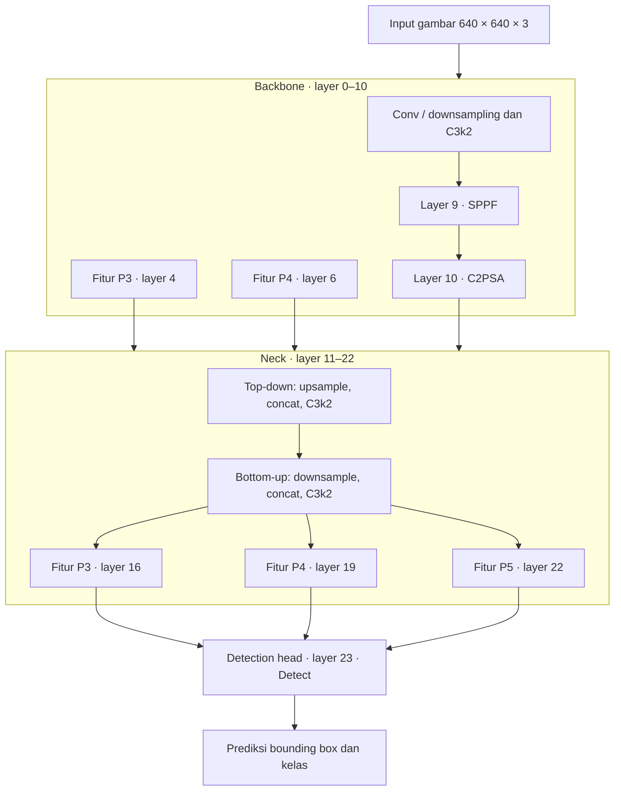
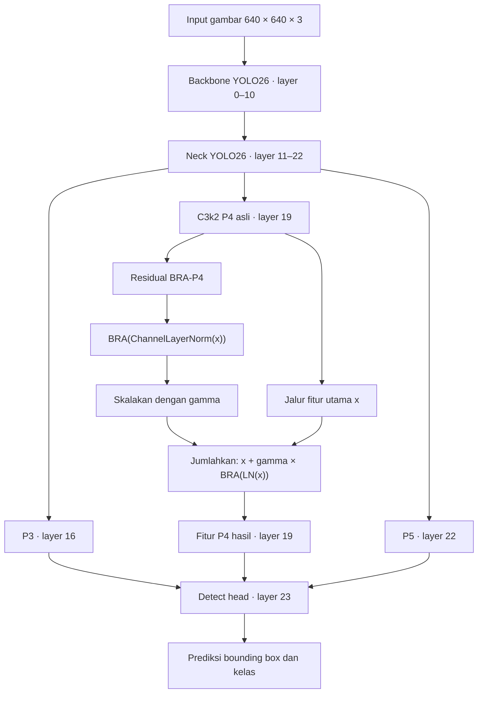

# Arsitektur Baseline YOLO26 dan Integrasi BRA

Dokumen ini menjelaskan alur kode eksperimen baseline YOLO26n dan eksperimen yang menambahkan Bi-Level Routing Attention (BRA) pada dataset aktif PlantDoc 28 kelas.

## Ringkasan proyek

- Bobot/arsitektur dasar: `yolo26n.pt` dari Ultralytics.
- Dataset: `plantdoc_data.yaml`, 28 kelas; jumlah kelas menentukan konfigurasi prediksi deteksi.
- Baseline 50 epoch: `configs/experiments/legacy_baseline_50e.yaml`.
- BRA 50 epoch: `configs/experiments/legacy_bra_p4_50e.yaml`, yang mewarisi config baseline.
- Entry point training eksperimen: `scripts/train.py`.

> **Catatan layer:** Indeks layer di bawah mengikuti graph YOLO26 24-layer yang divalidasi integrasi proyek. Layer di `yolo26n.pt` berasal dari Ultralytics; repository ini tidak mendefinisikan ulang seluruh YAML arsitektur YOLO26.

## 1. Blok diagram arsitektur baseline YOLO26

Backbone mengekstrak fitur visual dan menghasilkan representasi pada beberapa skala. Neck menggabungkan fitur tersebut melalui jalur top-down dan bottom-up. Head memakai tiga keluaran neck, yaitu layer `[16, 19, 22]`, untuk memprediksi objek pada skala P3, P4, dan P5.

Pembagian backbone/neck dan uraian layer lebih lanjut tersedia di [analisis arsitektur proyek](../Analisis_Arsitektur_YOLOv26_50Epochs.md). Beberapa uraian di dokumen historis tersebut merujuk eksperimen 30 kelas; eksperimen aktif yang dibahas di sini memakai 28 kelas sesuai `plantdoc_data.yaml`.

## 2. Blok diagram arsitektur setelah ditambahkan BRA

BRA dipasang pada keluaran blok C3k2 P4 di layer 19. Blok P4 asli tetap dijalankan, lalu keluarannya diproses oleh cabang residual BRA. Keluaran akhirnya tetap menjadi fitur P4 untuk detection head.

Dengan `gamma_init: 0.0`, cabang residual dimulai dalam keadaan tertutup: pada awal training keluaran BRA-P4 sama dengan fitur P4 asli. Parameter `gamma` dapat dipelajari selama training untuk menentukan besarnya kontribusi cabang BRA.

## 3. Bedah kode baseline menurut bagian arsitektur YOLO26

### Memilih model dan dataset

Config dasar [baseline.yaml](../configs/experiments/baseline.yaml) memilih `model: yolo26n.pt` dan `data: plantdoc_data.yaml`. Config baseline legacy kemudian mewarisi pengaturan itu dan menentukan protokol eksperimen; [legacy_baseline_50e.yaml](../configs/experiments/legacy_baseline_50e.yaml) menetapkan 50 epoch.

Di [scripts/train.py](../scripts/train.py), baris 41–46 memuat config dan menyelesaikan referensi model serta dataset. Baris 104 memuat model YOLO dari Ultralytics. Baris 113 memulai `model.train(...)`. Skrip ini mengatur training dan pencatatan eksperimen; ia tidak menulis lapisan backbone, neck, maupun head satu per satu.

### Backbone

Backbone berada di dalam graph model `yolo26n.pt` yang dimuat Ultralytics. Pada graph yang dirujuk proyek, bagian ini adalah layer 0–10: lapisan konvolusi dan C3k2 mengekstrak fitur bertahap, diikuti SPPF dan C2PSA di bagian dalam. Fitur dari beberapa tingkat dipakai lagi oleh neck.

### Neck

Neck berada di layer 11–22. Jalur top-down menggabungkan fitur semantik yang lebih dalam dengan fitur beresolusi lebih tinggi. Jalur bottom-up menggabungkan kembali fitur setelah downsampling. Tiga fitur yang diteruskan ke head berasal dari layer 16 (P3), 19 (P4), dan 22 (P5).

### Detection head

Head adalah layer 23 (`Detect`). Integrasi proyek memeriksa bahwa head menerima tepat fitur `[16, 19, 22]` di [yolo26.py](../src/plantdoc_attention/integrations/yolo26.py). Jumlah kelas mengikuti dataset; dataset aktif mendefinisikan `nc: 28` di [plantdoc_data.yaml](../plantdoc_data.yaml).

## 4. Lokasi implementasi BRA

| Peran | Lokasi kode | Yang dikerjakan |
|---|---|---|
| Aktifkan BRA untuk eksperimen | [legacy_bra_p4_50e.yaml](../configs/experiments/legacy_bra_p4_50e.yaml) | Memilih `kind: bra`, `layer: 19`, dimensi 128, 4 head, `n_win: 4`, `topk: 4`, dan `gamma_init: 0.0`. Config ini mewarisi resep baseline 50 epoch. |
| Memilih trainer attention | [scripts/train.py](../scripts/train.py) | Membaca `attention` dari config dan memilih `AttentionDetectionTrainer` bila konfigurasi tersebut ada (baris 104–106). |
| Memeriksa graph dan memasang wrapper | [integrations/yolo26.py](../src/plantdoc_attention/integrations/yolo26.py) | `attach_attention_p4()` memeriksa graph 24 layer, P4 di layer 19, channel 128, serta koneksi ke head; kemudian mengganti layer 19 dengan `P4AttentionWrapper` (baris 78–105). |
| Menghubungkan blok asli dan attention | [integrations/yolo26.py](../src/plantdoc_attention/integrations/yolo26.py) | `P4AttentionWrapper.forward()` menjalankan blok C3k2 asli, lalu cabang residual attention (baris 52–68). `AttentionDetectionTrainer.get_model()` memasang wrapper saat graph training dibangun (baris 121–144). |
| Residual gate dan normalisasi | [modules/residual_attention.py](../src/plantdoc_attention/modules/residual_attention.py) | `ResidualAttention.forward()` menghitung `x + gamma * BRA(ChannelLayerNorm(x))` (baris 31–49). |
| Operasi Bi-Level Routing Attention | [modules/bra.py](../src/plantdoc_attention/modules/bra.py) | `BiLevelRoutingAttention.forward()` membentuk Q/K/V, merutekan antarwilayah, memilih wilayah top-k, menghitung token attention, lalu mengembalikan fitur dengan bentuk semula (baris 38–126). |

Urutan aktivasi dalam training:

1. `legacy_bra_p4_50e.yaml` mewarisi baseline dan menambahkan blok `attention`.
2. `scripts/train.py` membaca konfigurasi itu, memuat `yolo26n.pt`, lalu memilih trainer attention.
3. Trainer membangun graph YOLO26, mentransfer bobot pretrained yang cocok, lalu memasang wrapper BRA pada layer 19.
4. Saat forward pass, fitur P4 melewati C3k2 asli dan residual BRA sebelum diteruskan ke head.

## Ringkasnya

Baseline adalah graph YOLO26n asli yang dilatih dengan konfigurasi dan dataset proyek. Varian BRA menggunakan graph serta resep baseline yang sama, kemudian menambahkan satu cabang attention residual pada fitur P4 layer 19. Implementasi inti BRA berada di `src/plantdoc_attention/modules/bra.py`; pengaitan ke graph YOLO26 berada di `src/plantdoc_attention/integrations/yolo26.py`.
